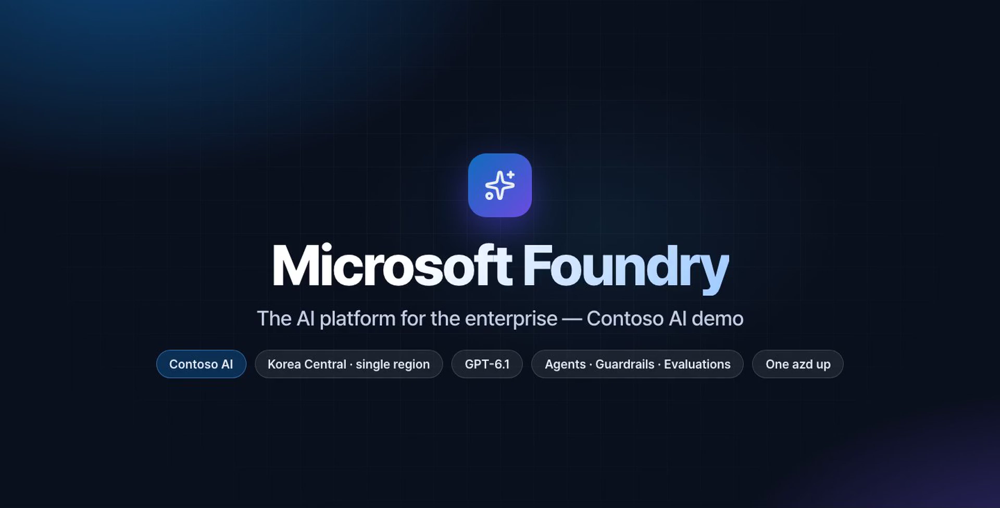
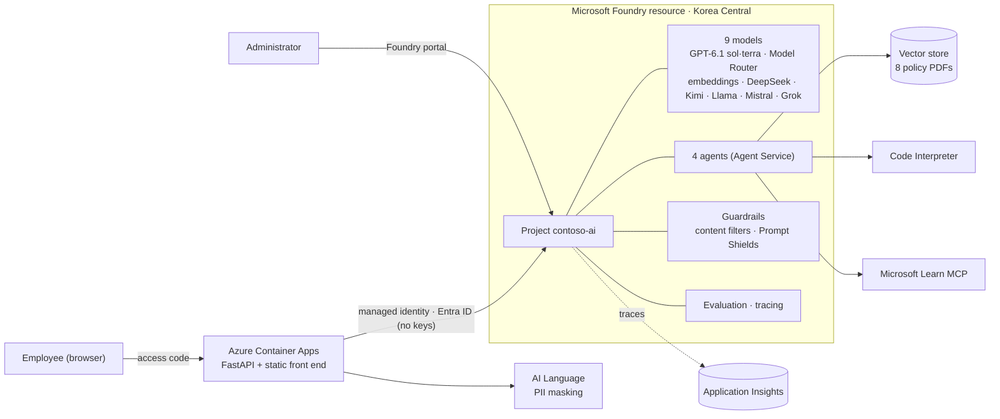

# Microsoft Foundry demo — Contoso AI (English edition)

> 한국어 설명은 [README.md](README.md) 를 보세요. This page is the English edition of the same demo kit.

A demo kit that shows what **Microsoft Foundry** is. It deploys a working environment to real Azure with one command and walks through it the way an enterprise would use it.

- **One `azd up`** deploys models, agents, guardrails, evaluation and observability to real Azure (a single region, Korea Central).
- **Employees** work in a ChatGPT-style web app, *Contoso AI*: document search, receipt reimbursement, data analysis, up-to-date technical docs and general chat.
- **Administrators** operate models, agents, guardrails, tracing and evaluation in the **Foundry portal itself** — the app has no admin screens of its own.
- A **recorded English demo video** (16 min 37 s, narrated and captioned) and matching **slides** (21 slides, PPTX) made from this code on a real deployment are included. Every on-screen string — the app, the Foundry portal, slides, captions — is English. The Korean video and slides are included too.

## Watch online — no download

Click to play the video or open the slides right in your browser (the demo videos inside the slides play too).

[](https://junwoojeong100.github.io/microsoft-foundry-demo/microsoft-foundry-demo-en.mp4)

| What | English | 한국어 (Korean) |
|---|---|---|
| **Full video** (1080p, narration + captions) | [▶ Play in the browser](https://junwoojeong100.github.io/microsoft-foundry-demo/microsoft-foundry-demo-en.mp4) — 16 min 37 s · 18 chapters | [▶ Play on the site](https://junwoojeong100.github.io/microsoft-foundry-demo/) — 18 min 54 s · 18 chapters · script |
| **Slides** (21 slides, 14 demo videos embedded) | [📑 Open in the browser](https://view.officeapps.live.com/op/view.aspx?src=https%3A%2F%2Fjunwoojeong100.github.io%2Fmicrosoft-foundry-demo%2Fslides%2FMicrosoft_Foundry_Demo_Deck_EN.pptx) | [📑 Open in the browser](https://view.officeapps.live.com/op/view.aspx?src=https%3A%2F%2Fjunwoojeong100.github.io%2Fmicrosoft-foundry-demo%2Fslides%2FMicrosoft_Foundry_Demo_Deck_KO.pptx) |
| **Jump to a chapter** of the video | [Deploy](https://junwoojeong100.github.io/microsoft-foundry-demo/microsoft-foundry-demo-en.mp4#t=135) · [Knowledge search](https://junwoojeong100.github.io/microsoft-foundry-demo/microsoft-foundry-demo-en.mp4#t=230) · [Task automation](https://junwoojeong100.github.io/microsoft-foundry-demo/microsoft-foundry-demo-en.mp4#t=299) · [Data analysis](https://junwoojeong100.github.io/microsoft-foundry-demo/microsoft-foundry-demo-en.mp4#t=351) · [Latest docs (MCP)](https://junwoojeong100.github.io/microsoft-foundry-demo/microsoft-foundry-demo-en.mp4#t=407) · [Chat · model choice](https://junwoojeong100.github.io/microsoft-foundry-demo/microsoft-foundry-demo-en.mp4#t=440) · [Safety](https://junwoojeong100.github.io/microsoft-foundry-demo/microsoft-foundry-demo-en.mp4#t=521) · [Agents as code](https://junwoojeong100.github.io/microsoft-foundry-demo/microsoft-foundry-demo-en.mp4#t=581) · [Admin: Models](https://junwoojeong100.github.io/microsoft-foundry-demo/microsoft-foundry-demo-en.mp4#t=631) · [Agents](https://junwoojeong100.github.io/microsoft-foundry-demo/microsoft-foundry-demo-en.mp4#t=703) · [Guardrails](https://junwoojeong100.github.io/microsoft-foundry-demo/microsoft-foundry-demo-en.mp4#t=749) · [Tracing](https://junwoojeong100.github.io/microsoft-foundry-demo/microsoft-foundry-demo-en.mp4#t=774) · [Evaluation](https://junwoojeong100.github.io/microsoft-foundry-demo/microsoft-foundry-demo-en.mp4#t=804) · [Operations](https://junwoojeong100.github.io/microsoft-foundry-demo/microsoft-foundry-demo-en.mp4#t=838) · [Adoption checklist](https://junwoojeong100.github.io/microsoft-foundry-demo/microsoft-foundry-demo-en.mp4#t=896) · [Wrap-up](https://junwoojeong100.github.io/microsoft-foundry-demo/microsoft-foundry-demo-en.mp4#t=956) | [한국어 챕터](README.md#브라우저에서-바로-보기--다운로드-없이) |
| **Download** | [PPTX](slides/Microsoft_Foundry_Demo_Deck_EN.pptx) · [MP4](video/microsoft-foundry-demo-en.mp4) · [SRT](video/microsoft-foundry-demo-en.srt) · [chapters](video/microsoft-foundry-demo-en.chapters.txt) | [PPTX](slides/Microsoft_Foundry_Demo_Deck_KO.pptx) · [MP4](video/microsoft-foundry-demo-ko.mp4) · [SRT](video/microsoft-foundry-demo-ko.srt) · [chapters](video/microsoft-foundry-demo-ko.chapters.txt) |

The videos are served by GitHub Pages, so they open in your browser's built-in player. The slides open in Microsoft's PowerPoint for the web: press ▶ on a slide's video to play it, **Notes** (bottom right) shows the spoken script, and **Start Slide Show** gives a full-screen view. The viewer uses its own fonts, so a few line breaks can differ slightly from desktop PowerPoint. For the exact layout, download the PPTX. The narration is AI-generated with Azure AI Speech.

## Switching the edition: `DEMO_LANG`

The same code base ships two editions. **Korean is the default.** Set `DEMO_LANG=en` for the English edition — the web UI, the agent instructions, the sample policy PDFs, the CSV data, the receipts and the evaluation questions are all English, and the deployment scripts print English messages.

```bash
azd env new contoso-demo-en          # a separate environment keeps the Korean one untouched
azd env set DEMO_LANG en
azd up                               # about 8–10 minutes · region: koreacentral
```

| | Korean (`DEMO_LANG` unset or `ko`) | English (`DEMO_LANG=en`) |
|---|---|---|
| Seed data | `src/web/seed/` | `src/web/seed_en/` |
| Agent instructions · UI strings | `src/web/app/agents_def.py` · `src/web/static/js/*.js` (Korean literals) | same files, English branch (`tt(ko, en)` / `pick(ko, en)`) |
| Evaluation | `python scripts/run_evals.py` | `python scripts/run_evals.py --lang en` |
| Video pipeline | `recording/` (`REC_LANG` unset) | `REC_LANG=en` → `audio_en/`, `raw_en/`, `slides_en.html`, `script_en.py` |

Give the English edition its **own Foundry project / environment**: the agent names and the vector store (`contoso-knowledge`) are shared between editions, so a project that was already bootstrapped in Korean would reuse the Korean files.

## What the demo shows

| Area | What you see | Foundry features used |
|---|---|---|
| Deployment | A recording of the real `azd up` run | Foundry resource and project, 9 model deployments, a guardrail policy and the Application Insights connection — all from **one Bicep template** |
| Knowledge search | Answers from 8 policy PDFs **with sources** (Contoso Guide) | Agent Service, file search (vector store), embeddings |
| Task automation | Receipt photo → policy check → submit **after human approval** (Contoso Pay) | Vision, function calling, user approval (human in the loop) |
| Data analysis | CSV anomaly + customer-feedback cross-analysis, charts (Contoso Analyst) | Code Interpreter |
| Latest knowledge | Answers from official Microsoft Learn docs (Contoso Architect) | MCP tool |
| General chat | Web search, switching models, Model Router | Multi-vendor model catalog (GPT-6.1 · DeepSeek · Kimi · Llama · Mistral · Grok), Model Router |
| Safety | Automatic personal-data masking, jailbreak blocking | AI Language (PII), guardrails (Prompt Shields · content filters) |
| Administration | Models, agents (versions · YAML · publishing), guardrails, tracing, evaluation, quota, project | **Foundry portal** (the app has no admin features) |

## Architecture



- The app reaches Foundry only through a **user-assigned managed identity + RBAC**. Key authentication on the Foundry resource is **turned off** (`disableLocalAuth`).
- The app image is built by **Azure Container Registry remote build** (no local Docker), and the image is pulled with the managed identity too.
- On first start the app uploads the policy PDFs to a vector store and creates the 4 agents (Contoso Guide gets v1 = model only and v2 = knowledge connected). The definitions live in one file, `src/web/app/agents_def.py`.

### The 9 models

| Deployment | Role | Type · capacity (Bicep value) |
|---|---|---|
| `gpt-6.1-sol` | Flagship — Pay · Analyst · Architect agents | GlobalStandard · 100 |
| `gpt-6.1-terra` | Fast — Guide agent, default for general chat | GlobalStandard · 200 |
| `model-router` | Picks a model by question difficulty | GlobalStandard · 100 |
| `text-embedding-3-large` | Vector store embeddings | Standard · 120 |
| `deepseek-v4-pro` · `kimi-k3.1-pro` · `llama-4-maverick` · `mistral-large-3` | Model comparison in general chat | GlobalStandard · 50 each |
| `grok-4.7` | ″ | GlobalStandard · 20 |

> Capacity is in units of 1K TPM or RPM depending on the model. If quota is short or a model is not available, reduce the capacity in `coreModels` / `multiVendorModels` of [`infra/main.bicep`](infra/main.bicep) or set `deployMultiVendorModels` to `false`.

## Quick start

**Prerequisites**: an Azure subscription (Owner, or Contributor + User Access Administrator — Bicep assigns roles), the [Azure CLI](https://aka.ms/installazurecli) and the [Azure Developer CLI (azd)](https://aka.ms/azd). Docker is not needed. You need quota for the models above in the chosen region.

```bash
git clone <this repository> microsoft-foundry-demo && cd microsoft-foundry-demo
az login
azd auth login

azd env new contoso-demo-en && azd env set DEMO_LANG en
azd up            # region: koreacentral · about 8–10 minutes
```

When it finishes, the terminal prints the web address and the access code. You can show them again at any time:

```bash
azd env get-value WEB_URI            # employee app address
azd env get-value DEMO_ACCESS_CODE   # access code (generated on first deployment)
```

The admin view is the [Foundry portal](https://ai.azure.com) → project **contoso-ai**. The *Admin console · Foundry portal* link at the bottom left of the app opens it too.

If you change the app, run only `azd deploy web`. To clean up (`--purge` fully removes the deleted Foundry resource):

```bash
azd down --purge --force
```

## Run the web app locally

Connects to a deployed Foundry project and runs only the web app on your computer (no access code, requires `az login`).

```bash
python3.12 -m venv .venv && .venv/bin/pip install -r requirements-dev.txt
DEMO_LANG=en ./scripts/dev_local.sh          # http://127.0.0.1:8000
```

## Agent quality evaluation

Scores **v1 (model only)** and **v2 (policies connected)** of Contoso Guide on the same 22 questions with Foundry's built-in evaluators (relevance · similarity · groundedness). The results also appear in the portal's *Evaluations* page.

```bash
.venv/bin/python scripts/run_evals.py --lang en            # about 4–6 minutes
.venv/bin/python scripts/run_evals.py --lang en --limit 8  # a quick subset
```

## Rebuilding the video

Script, narration, recording and assembly are all code. For the English edition set `REC_LANG=en`; see [docs/recording.md](docs/recording.md) (Korean) — in short:

```bash
export REC_LANG=en
export SPEECH_ENDPOINT=https://<your-speech-resource>.cognitiveservices.azure.com   # optional: any Azure AI Speech endpoint with Entra ID access
export SPEECH_SUBSCRIPTION=<subscription of the Speech resource>                     # optional
python recording/save_portal_state.py --lang en --auto      # sign in to the Foundry portal once (English UI)
python recording/tts.py --lang en --build                   # narration: script_en.py → audio_en/ (voice en-US-Andrew:DragonHDLatestNeural)
python recording/record.py all-slides S03_deploy            # slides, chapter cards, the real azd up replay
python recording/record.py all-app                          # employee app scenes (the deployed English app)
python recording/record.py all-portal                       # Foundry portal scenes (English portal UI)
python recording/compose.py                                 # video/microsoft-foundry-demo-en.mp4 + chapters + captions + thumbnail
```

The slide decks are built from the finished video and are not generated in this repository. To publish a new version, copy it with `python scripts/publish_deck.py <deck.pptx> --lang en` (or `ko`): it writes the public copy to [`slides/`](slides/) with personal metadata removed. Pushing to `main` deploys it to the site, and the *Open in the browser* links above show it in PowerPoint for the web.

## How the demo differs from production

The demo is intentionally simple. For production, turn on or change the following.

| Item | Demo | In production |
|---|---|---|
| App sign-in | One access code | Entra ID sign-in (SSO · MFA), per-user permissions |
| Network | Public endpoints | Private endpoints · virtual networks |
| Data | Fictional documents | Connect real documents; honor sensitivity labels and access rights |
| Processing location | `GlobalStandard` deployments | Check the deployment type · region for your requirements (`DataZoneStandard` and so on) |
| Security · governance | Guardrails + least-privilege RBAC | Defender · Purview · Azure Policy |
| Cost · limits | Per-deployment TPM quota | Quota + budget alerts, reserve PTU if needed, consider API Management (AI Gateway) for per-team limits |

All sample documents, receipts and numbers are **fictional** and unrelated to any real company. To change them, edit `scripts/sample_content.py` (Korean) / `scripts/sample_content_en.py` (English) and run `scripts/build_sample_docs.py [--lang en]` and `scripts/build_sample_data.py [--lang en]` (numbers appear in both the policies and the evaluation questions, so change them together).

## Troubleshooting

| Symptom | What to do |
|---|---|
| A model deployment fails because of quota | Check the quota of that model in the region, then reduce the capacity in `infra/main.bicep` or turn the multi-vendor models off |
| `azd deploy` fails with `BlobNotFound … rawtext.log` | A transient error: the ACR build log was not ready yet. Run `azd deploy web` again |
| The app says "preparing" for a long time | `curl "$(azd env get-value WEB_URI)/healthz"` should show `"bootstrap":"ready"`; otherwise `az containerapp logs show -n $(azd env get-value WEB_APP_NAME) -g $(azd env get-value AZURE_RESOURCE_GROUP)` |
| The agents do not appear in the portal | The signed-in account needs the **Azure AI User** role on the Foundry resource |

Licenses of the open-source components are in [THIRD_PARTY_NOTICES.md](THIRD_PARTY_NOTICES.md).
