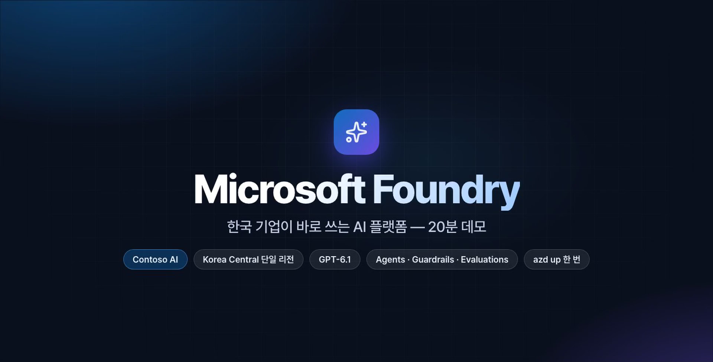
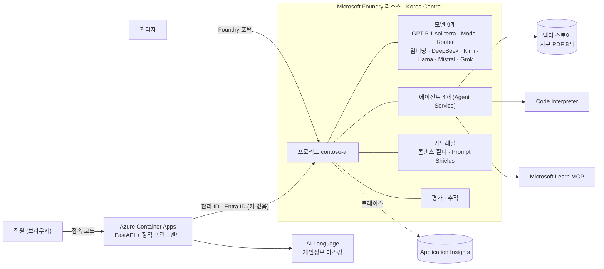

# Microsoft Foundry 데모 — Contoso AI

한국 기업 고객에게 **Microsoft Foundry** 가 무엇인지 보여 주기 위한 데모 키트입니다.

- **`azd up` 한 번**으로 모델·에이전트·가드레일·평가·관측까지 실제 Azure 에 배포합니다 (한국 중부 리전 하나).
- **직원**은 ChatGPT 같은 웹 앱 *Contoso AI* 로 일합니다 — 문서 검색, 영수증 정산, 데이터 분석, 최신 기술 문서, 일반 채팅.
- **관리자**는 앱을 따로 만들지 않고 **Foundry 포털 화면 그대로** 모델·에이전트·가드레일·추적·평가를 운영합니다.
- 이 코드로 직접 배포해 녹화한 **약 19분 한국어 데모 영상**(내레이션·자막 포함)이 들어 있습니다.

> **English edition** — 화면·샘플 문서·내레이션·자막이 모두 영어인 영문판(`DEMO_LANG=en`)도 같은 코드로 만들 수 있습니다. [README.en.md](README.en.md) 를 보세요.

[](https://junwoojeong100.github.io/microsoft-foundry-demo/)

> **▶ 웹사이트에서 보기: <https://junwoojeong100.github.io/microsoft-foundry-demo/>** — 18분 54초 · 1080p · 한국어 내레이션과 자막 · 챕터 18개(눌러서 이동) · 대본 · 기능별 바로가기
> 영상 파일은 [video/microsoft-foundry-demo-ko.mp4](video/microsoft-foundry-demo-ko.mp4)(77.7MB), 챕터는 [.chapters.txt](video/microsoft-foundry-demo-ko.chapters.txt), 자막은 [.srt](video/microsoft-foundry-demo-ko.srt) 입니다. 장면별 진행 방법과 예상 질문은 [docs/demo-guide.md](docs/demo-guide.md) 를 보세요.

## 데모가 보여 주는 것

| 영역 | 내용 | 사용한 Foundry 기능 |
|---|---|---|
| 배포 | `azd up` 실제 실행 기록 | Foundry 리소스·프로젝트, 모델 배포 9개, 가드레일 정책, Application Insights 연결을 **Bicep 한 벌**로 |
| 지식 검색 | 사규 PDF 8개에 **출처와 함께** 답변 (Contoso Guide) | Agent Service, 파일 검색(벡터 스토어), 임베딩 |
| 업무 자동화 | 영수증 사진 → 규정 검토 → **사람 승인 후** 상신 (Contoso Pay) | 비전, 함수 호출, 사용자 승인(Human-in-the-loop) |
| 데이터 분석 | CSV 이상 징후 + 고객 의견 교차 분석, 차트 (Contoso Analyst) | Code Interpreter |
| 최신 지식 | Microsoft Learn 공식 문서로 답변 (Contoso Architect) | MCP 도구 |
| 일반 채팅 | 웹 검색, 모델 바꾸기, Model Router | 멀티벤더 모델 카탈로그(GPT-6.1·DeepSeek·Kimi·Llama·Mistral·Grok), Model Router |
| 안전장치 | 개인정보 자동 마스킹, 탈옥 시도 차단 | AI Language(PII), 가드레일(Prompt Shields·콘텐츠 필터) |
| 관리자 | 모델·에이전트(버전·YAML·게시)·가드레일·추적·평가·할당량·프로젝트 | **Foundry 포털** (앱에는 관리 기능이 없습니다) |

## 아키텍처



- 앱 → Foundry 는 **사용자 할당 관리 ID + 역할(RBAC)** 로만 접근합니다. Foundry 리소스는 **키 인증을 꺼 두었습니다**(`disableLocalAuth`).
- 앱 이미지는 로컬 Docker 없이 **Azure Container Registry 원격 빌드**로 만들고, ACR 에서 이미지를 가져올 때도 관리 ID 를 씁니다.
- 첫 기동 때 앱이 사규 PDF 를 벡터 스토어에 올리고 에이전트 4개(Contoso Guide 는 v1 모델만 · v2 지식 연결)를 만듭니다. 이 정의가 `src/web/app/agents_def.py` 한 파일에 있습니다.

### 모델 9개

| 배포 이름 | 역할 | 유형 · 용량(Bicep 값) |
|---|---|---|
| `gpt-6.1-sol` | 주력 — Pay·Analyst·Architect 에이전트 | GlobalStandard · 100 |
| `gpt-6.1-terra` | 빠른 응답 — Guide 에이전트, 일반 채팅 기본 | GlobalStandard · 200 |
| `model-router` | 질문 난이도에 따라 모델을 골라 줌 | GlobalStandard · 100 |
| `text-embedding-3-large` | 벡터 스토어 임베딩 | Standard · 120 |
| `deepseek-v4-pro` · `kimi-k3.1-pro` · `llama-4-maverick` · `mistral-large-3` | 일반 채팅의 모델 비교용 | GlobalStandard · 각 50 |
| `grok-4.7` | 〃 | GlobalStandard · 20 |

> 용량의 단위는 모델에 따라 1K TPM 또는 RPM 입니다. 쿼터가 부족하거나 지원하지 않는 모델이 있으면 [`infra/main.bicep`](infra/main.bicep) 의 `coreModels`·`multiVendorModels` 에서 용량을 줄이거나 `deployMultiVendorModels` 를 `false` 로 바꾸세요. 앱은 모델 **배포 이름**만 알고 있습니다.

## 빠른 시작

**준비물**: Azure 구독(구독 소유자, 또는 기여자 + 사용자 액세스 관리자 — Bicep 이 역할을 부여합니다), [Azure CLI](https://aka.ms/installazurecli), [Azure Developer CLI(azd)](https://aka.ms/azd). Docker 는 필요 없습니다. 선택한 리전에서 위 모델의 쿼터가 있어야 합니다.

```bash
git clone <이 저장소> microsoft-foundry-demo && cd microsoft-foundry-demo
az login
azd auth login

azd up            # 환경 이름 예: contoso-demo · 리전: koreacentral · 약 8~10분
```

끝나면 터미널에 접속 주소와 접속 코드가 출력됩니다. 언제든 다시 확인할 수 있습니다.

```bash
azd env get-value WEB_URI            # 직원용 앱 주소
azd env get-value DEMO_ACCESS_CODE   # 접속 코드(처음 배포할 때 자동으로 만들어집니다)
```

관리자 화면은 [Foundry 포털](https://ai.azure.com) → 프로젝트 **contoso-ai** 입니다. 앱 왼쪽 아래의 *관리자 콘솔 · Foundry 포털* 링크로도 열립니다.

앱을 고쳤다면 `azd deploy web` 만 다시 실행하면 됩니다. 정리할 때는 다음 명령을 씁니다(`--purge` 는 삭제된 Foundry 리소스를 완전히 비웁니다).

```bash
azd down --purge --force
```

### `azd up` 이 하는 일

1. **preprovision 훅** — 리소스 공급자 등록, 배포한 사람의 Entra 객체 ID 확인, 데모 접속 코드 생성
2. **Bicep**(`infra/`) — 리소스 그룹, Log Analytics·Application Insights, 관리 ID, Foundry 리소스·프로젝트·가드레일·모델 9개, ACR, Container Apps
3. **이미지 빌드·배포** — `src/web` 을 ACR 원격 빌드해 Container App 에 올림
4. **postdeploy 훅** — 앱의 첫 기동 준비(문서 인덱싱·에이전트 생성)가 끝날 때까지 기다리고 접속 정보를 출력

## 로컬에서 실행하기

배포된 Foundry 프로젝트에 붙어서 웹 앱만 내 컴퓨터에서 실행합니다(접속 코드 없음, `az login` 필요).

```bash
python3.12 -m venv .venv && .venv/bin/pip install -r requirements-dev.txt
./scripts/dev_local.sh          # http://127.0.0.1:8000
```

## 에이전트 품질 평가

Foundry 내장 평가기(관련성·정답 일치도·근거 충실도)로 Contoso Guide 의 **v1(모델만)** 과 **v2(사규 연결)** 를 같은 질문 22개로 채점합니다. 결과는 포털의 *평가* 화면에도 남습니다.

```bash
.venv/bin/python scripts/run_evals.py            # 약 4~6분
.venv/bin/python scripts/run_evals.py --limit 8  # 빠르게 일부만
```

## 화면 점검(E2E)

실제 UI 를 눌러 가며 각 기능이 끝까지 동작하는지 스크린샷과 함께 확인합니다.

```bash
.venv/bin/python scripts/qa_flows.py knowledge expense analyst architect general safety \
  --base "$(azd env get-value WEB_URI)" --code "$(azd env get-value DEMO_ACCESS_CODE)"
```

## 폴더 구조

```
azure.yaml            azd 설정 (web 서비스, 배포 전후 훅)
infra/                Bicep — Foundry·모델·가드레일·Container Apps·관측·RBAC
src/web/app/          FastAPI 백엔드: 에이전트 정의, 스트리밍 채팅, 안전장치, 첫 기동 준비
src/web/static/       ChatGPT 스타일 프런트엔드 (빌드 도구 없는 Preact + htm)
src/web/seed/         가상 사규 PDF 8개 · 판매/VOC CSV · 영수증 · 평가 질문 22개
src/web/seed_en/      위의 영문판 (DEMO_LANG=en 일 때 사용)
scripts/              로컬 실행, 샘플 데이터 생성, 평가 실행, 화면 점검, 배포 훅
recording/            데모 영상 제작 파이프라인 (대본·음성·녹화·조립)
docs/                 데모 진행 가이드, 영상 다시 만들기
video/                완성된 데모 영상 · 챕터 · 자막 · 썸네일 · 포스터
site/                 GitHub Pages 사이트 소스 (랜딩 페이지 · 문서 뷰어)
.github/workflows/    main 에 push 하면 사이트를 다시 만들어 배포하는 워크플로
```

샘플 문서·영수증·수치는 모두 **가상**이며 실제 기업과 무관합니다. 내용을 바꾸려면 `scripts/sample_content.py` 를 고치고 `scripts/build_sample_docs.py`, `scripts/build_sample_data.py` 를 실행하세요(숫자는 사규와 평가 질문 양쪽에 있으니 함께 고쳐야 합니다).

## 이 데모와 운영 환경의 차이

이 데모는 *시연*이 목적이라 일부러 단순하게 구성했습니다. 운영에 쓰려면 다음을 켜거나 바꾸세요.

| 항목 | 데모 | 운영에서는 |
|---|---|---|
| 앱 로그인 | 접속 코드 한 개 | Entra ID 로그인(SSO·MFA), 사용자별 권한 |
| 네트워크 | 공개 엔드포인트 | 프라이빗 엔드포인트 · 가상 네트워크 |
| 데이터 | 가상 문서 | 실제 문서 연결, 민감도 레이블·접근 권한 반영 |
| 처리 위치 | `GlobalStandard` 배포 | 요건에 맞는 배포 유형·리전(`DataZoneStandard` 등) 확인 |
| 보안·거버넌스 | 가드레일 + 최소 권한 RBAC | Defender · Purview · Azure Policy 연동 |
| 비용·한도 | 배포별 TPM 쿼터 | 쿼터 + 예산 알림, 필요 시 PTU 예약, 팀·개인별 한도는 API Management(AI Gateway) 검토 |

## 문제 해결

| 증상 | 조치 |
|---|---|
| 모델 배포가 쿼터 때문에 실패 | 선택한 리전의 해당 모델 쿼터를 확인하고, `infra/main.bicep` 에서 용량을 줄이거나 멀티벤더 모델을 끄세요 |
| `azd deploy` 가 `BlobNotFound … rawtext.log` 로 실패 | ACR 빌드 로그가 아직 만들어지지 않아 azd 가 읽지 못한 일시적인 오류입니다. `azd deploy web` 을 다시 실행하세요 |
| 앱이 한참 "준비 중" | `curl "$(azd env get-value WEB_URI)/healthz"` 가 `"bootstrap":"ready"` 인지 확인하고, 아니면 `az containerapp logs show -n $(azd env get-value WEB_APP_NAME) -g $(azd env get-value AZURE_RESOURCE_GROUP)` |
| 포털에서 에이전트가 보이지 않음 | 로그인한 계정에 Foundry 리소스의 **Azure AI User** 역할이 필요합니다 |

## 영상 다시 만들기

대본·장면·조립이 모두 코드입니다. 대본(`recording/script_ko.py`)이나 장면(`recording/scenes.py`)을 고쳐 다시 만들 수 있습니다 — 방법은 [docs/recording.md](docs/recording.md) 를 보세요.

영문판 영상은 `REC_LANG=en`(대본 `recording/script_en.py`)으로 같은 파이프라인을 돌려 만듭니다. 한국어판 결과물(`recording/raw/`, `audio/`, `video/…-ko.*`)은 건드리지 않고 `raw_en/`, `audio_en/`, `video/…-en.*` 에 따로 만들어집니다.

## 웹사이트 (GitHub Pages)

<https://junwoojeong100.github.io/microsoft-foundry-demo/> 는 **`main` 브랜치에 push 할 때마다 GitHub Actions 가 자동으로 빌드·배포**합니다([`.github/workflows/pages.yml`](.github/workflows/pages.yml)).

- 페이지 틀은 `site/`, 영상·자막·챕터는 `video/`, 문서는 `docs/` 에서 가져옵니다. [`scripts/build_site.py`](scripts/build_site.py)(표준 라이브러리만 사용)가 챕터 목록·영상 길이·용량·대본·자막(VTT)을 영상 파일에서 읽어 채우므로, **`video/` 를 새로 만들어 push 하면 사이트도 저절로 바뀝니다.**
- 이 저장소를 포크했다면 Settings → Pages → Source 를 **GitHub Actions** 로 한 번만 바꾸세요. 주소는 `https://<내 계정>.github.io/<저장소 이름>/` 으로 자동 계산됩니다.
- 내 컴퓨터에서 미리 보기:

```bash
python scripts/build_site.py          # _site/ 에 만듭니다
cd _site && python -m http.server 8080   # http://localhost:8080
```

> 간단한 `http.server` 는 영상 구간 요청(Range)을 지원하지 않아 건너뛰기가 느릴 수 있습니다. 배포된 GitHub Pages 에서는 정상 동작합니다.

오픈소스 구성 요소의 라이선스는 [THIRD_PARTY_NOTICES.md](THIRD_PARTY_NOTICES.md) 에 있습니다.
